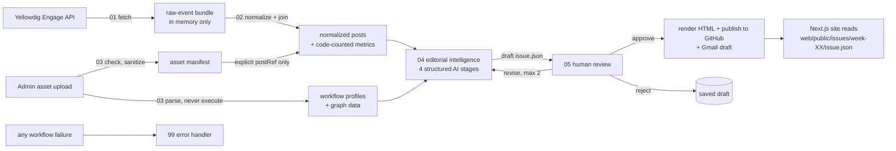
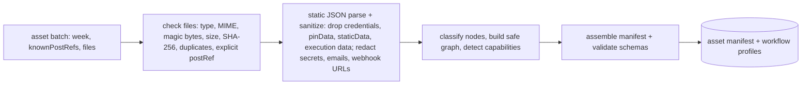

# Architecture — CIS 515 Workflow Observatory

Status: **Phases 0–4 complete** (audit, contracts, source layer, workflows 01–02, workflow-asset profiling with workflow 03, and evidence-grounded editorial intelligence with workflow 04). Sections marked _Planned_ are not built yet.

## Product

- **CIS 515 Workflow Observatory**: the public Next.js site (issues, explore, atlas, trends, methodology) plus a protected admin.
- **CIS 515 Community Dispatch**: the weekly newsletter, published as `issue.json` and a standalone `newsletter.html`.

## Environments

| Environment | Role |
|---|---|
| VS Code + Claude Code | Development. n8n changes go through the n8n Cloud MCP server. |
| GitHub (`Rithikroyt/CIS-515-Weekly-Yellowdig-Posts-Newsletter`) | Source of truth for code, schemas, sanitized workflow exports and **approved** issues. The repository is public. |
| n8n Cloud (`rithikroy18.app.n8n.cloud`) | Live automation backend. |
| Vercel | Hosts the Next.js app (`web/`). _Planned._ |
| Local Docker (`n8n/docker-compose.yml`) | Optional sandbox only. |

## Data flow

## Responsibilities

- **Code** computes every number: posts, comments, unique authors, reactions and views (when available), most discussed, most active commenters, topic counts, workflow node and edge counts, and the reliability signals (code checks, human review, bounded retries, error handling, external services).
- **AI** writes prose only: summaries, theme descriptions, spotlight narratives, discussion synthesis, headline and introduction, lessons and takeaways. Every AI claim carries source IDs, and code checks them.
- **A person** approves before anything is published.

## Shared logic

Deterministic logic is written once in TypeScript under `web/src/lib/` and used by the web app, the tests and n8n:

| Module | Purpose |
|---|---|
| `lib/metrics.ts`, `lib/ids.ts` | Code-counted metrics, hashing, pseudonymous ids (Phase 1) |
| `lib/source/` | Run config, Phoenix date windows, Yellowdig field map and privacy boundary, pagination and failure handling, dedupe, topic/date filter, normalization and joins, capability probe, synthetic Week 2 provider |
| `lib/editorial/` | Phase 4: editorial input package, versioned prompts, deterministic evidence checks, bounded-revision state machine, provider adapter (Gemini, mock). See [editorial-intelligence.md](editorial-intelligence.md) |
| `lib/assets/` | Phase 3: file checks, static parse and sanitization, node classifier, graph and capability detection, asset manifest, synthetic workflow fixtures. See [workflow-asset-profiling.md](workflow-asset-profiling.md) |
| `lib/contracts/` | Zod types, plain vocabularies (`vocab.ts`), and a small JSON Schema validator that reads `/schemas` (n8n has no Ajv or Zod) |
| `n8n/nodes/wf01.ts` … `wf04.ts` | One thin entry per n8n Code node; each calls one shared stage |

`npm run build:n8n` bundles each entry with esbuild into `n8n/src/generated/<wf>/<entry>.js` and fills the SDK templates in `n8n/sdk/`. Drift is caught three ways:

- `bundles.test.ts` runs the bundles in a simulated Code node and requires the committed bundles to match a fresh build.
- `npm run validate` requires every Code node in the committed exports to equal a generated bundle.
- `export-n8n.ts` refuses to export a workflow whose Code nodes differ from the bundles.

### Source layer (Phase 2)

```mermaid
flowchart LR
  CFG[run config] --> V[validate + resolve mode]
  V -->|fixture / auto without credential| FX[synthetic Yellowdig-shaped pages]
  V -->|yellowdig / auto with credential| PR[capability probe, 10 events] --> PG[cursor pagination, 250/page]
  PG -->|401/403/429/5xx| CL[classify: retry with backoff, fallback only in auto, else fail]
  CL -->|fallback| FX
  FX --> MIN[collect pages + privacy minimize]
  PG --> MIN
  MIN --> DD[dedupe by event id] --> FL[Phoenix date + structured topic filter] --> SB[(source bundle)]
  SB --> N2[02: validate, classify, join, metrics, validate] --> WD[(week dataset)]
```

### Workflow assets (Phase 3)

Uploaded workflows are parsed as data and never executed. Screenshots are validated and hashed only.

## n8n workflows

| Workflow | Status |
|---|---|
| 01 - Yellowdig Fetch Events | **Built** in n8n Cloud (`dHZoXDny6WU1v62y`), export `n8n/workflows/01-fetch-yellowdig-events.json`. Fixture mode tested; Yellowdig branch tested with pinned synthetic HTTP responses only. Not published. |
| 02 - Yellowdig Normalize and Join | **Built** in n8n Cloud (`ZZoqGbrNSC3nAo3f`), export `n8n/workflows/02-normalize-and-join.json`. 01 → 02 tested in fixture mode. Not published. |
| 03 - Profile Workflow Assets | **Built** in n8n Cloud (`L2fnEPtg0te7KTbG`), export `n8n/workflows/03-profile-workflow-assets.json`. Called by another workflow (no webhook), Code nodes only: no AI, no HTTP, no credentials. Tested with the synthetic batch only; the output matched the local pipeline exactly. Not published. Supersedes the prototype parser `n8n/src/parse-workflows.js`. |
| 04 - Editorial Intelligence | **Built** in n8n Cloud (`U2uwnaV09NohVmjn`), export `n8n/workflows/04-editorial-intelligence.json`. Shared state machine in one Code node; model calls via the mock (synthetic only) or a Gemini HTTP node using an n8n credential (not attached; live use unverified). Ends at `human_review`. Not published. |
| 05-review-and-publish | _Planned_ (needs GitHub and Gmail credentials) |
| 99-error-handler | _Planned_ |
| Dispatch · Ingest, Dispatch · Parse (prototypes, in n8n Cloud) | Superseded by 01–03. They will be archived in n8n once their replacements pass tests. |
| ActionReady - Week 2 Yellowdig FINAL | Unrelated earlier project. Archived at `n8n/workflows/archive/actionready-week2.json`. |
