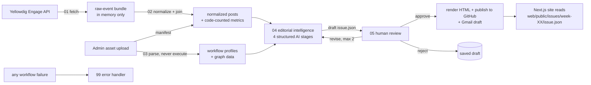

# Architecture — CIS 515 Workflow Observatory

Status: **Phase 0 (audit) complete.** Sections marked _Planned_ are not built yet.

## Product

- **CIS 515 Workflow Observatory**: the public Next.js site (issues, explore, atlas, trends, methodology) plus a protected admin.
- **CIS 515 Community Dispatch**: the weekly newsletter, published as `issue.json` and a standalone `newsletter.html`.

## Environments

| Environment | Role |
|---|---|
| VS Code + Claude Code | Development. n8n changes go through the n8n Cloud MCP server. |
| GitHub (`Rithikroyt/CIS-515-Weekly-Yellowdig-Posts-Newsletter`) | Source of truth for code, schemas, sanitized workflow exports and **approved** issues. The repository is public. |
| n8n Cloud (`rithikroy18.app.n8n.cloud`) | Live automation backend. |
| Vercel | Hosts the Next.js app (`web/`). _Planned._ |
| Local Docker (`n8n/docker-compose.yml`) | Optional sandbox only. |

## Data flow

## Responsibilities

- **Code** computes every number: posts, comments, unique authors, reactions and views (when available), most discussed, most active commenters, topic counts, workflow node and edge counts, and the reliability signals (code checks, human review, bounded retries, error handling, external services).
- **AI** writes prose only: summaries, theme descriptions, spotlight narratives, discussion synthesis, headline and introduction, lessons and takeaways. Every AI claim carries source IDs, and code checks them.
- **A person** approves before anything is published.

## Shared logic (_Planned_)

The deterministic parts (normalization, metrics, workflow profiling, the HTML renderer and validation) are written once in TypeScript under `web/lib/`. They are used by the web app and the tests, and are bundled into plain JavaScript (`n8n/src/generated/`) for n8n Code nodes. The web app, the n8n workflows and the tests therefore compute the same numbers from the same code.

## n8n workflows

| Workflow | Status |
|---|---|
| 01-fetch-yellowdig-events | _Planned_ |
| 02-normalize-and-join | _Planned_ |
| 03-parse-workflow-assets | _Planned_ (reuses the tested parser in `n8n/src/parse-workflows.js`) |
| 04-editorial-intelligence | _Planned_ (needs an LLM credential) |
| 05-review-and-publish | _Planned_ (needs GitHub and Gmail credentials) |
| 99-error-handler | _Planned_ |
| Dispatch · Ingest, Dispatch · Parse (prototypes, in n8n Cloud) | Superseded by 01–03. They will be archived in n8n once their replacements pass tests. |
| ActionReady - Week 2 Yellowdig FINAL | Unrelated earlier project. Archived at `n8n/workflows/archive/actionready-week2.json`. |
