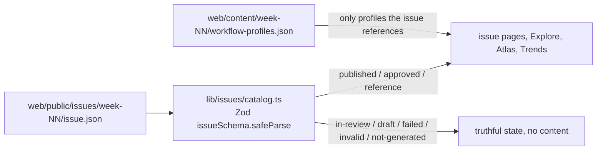

# Frontend architecture

The public site is a static Next.js 15 App Router app in `web/`. Every page is built from frozen files. The browser never calls Yellowdig, n8n or an LLM, and nothing in the UI recomputes a metric.

## Issue loading

- `loadWeek(n)` reads one file, validates it at the boundary and classifies the week (see [route-and-state-map.md](route-and-state-map.md)). Invalid files report schema paths only, never values.
- An issue marked `provenance.synthetic` or with `sourceSummary.verified: false` is a **reference** issue. It is shown with a prominent synthetic-data label and is never presented as class data.
- `/issues/[week]` uses `generateStaticParams` for Weeks 1–5 with `dynamicParams = false`. Changing weeks is plain navigation to an already-built page.
- Real issues will be written into `web/public/issues/week-NN/` by the Phase 5 publish step. `scripts/render-issues.ts` currently copies only the synthetic Week 2 fixture.

## Newsletter

- `lib/render/newsletter.ts` turns an `issue.json` into a standalone HTML file. It is deterministic and escapes every value. It has inline CSS only, no scripts and no external resources, plus its own CSP meta tag.
- `npm run issues:render` writes `newsletter.html` next to `issue.json`. A test fails if the committed file differs from a fresh render.
- `next.config.ts` serves `newsletter.html` with `Content-Security-Policy: default-src 'none'; style-src 'unsafe-inline'; img-src 'self' data:; sandbox`.
- The preview is `<iframe sandbox="">`: no scripts, no same-origin access, no access to the parent page. "Open full screen", "Download HTML" and "Download issue data" use plain links. "Download PDF" appears only when `newsletter.pdf` exists, which is never at present. Printing uses the browser's Print command on the full-screen newsletter.

## Workflow graph

- `lib/graph/layout.ts` is a pure, deterministic layered layout. Columns follow main and error edges breadth-first from triggers, and AI components sit under the node they serve.
- `/atlas` computes layouts on the server. The client component `WorkflowGraph` only handles pan, zoom and path highlighting.
- Every graph has a text alternative listing each step and where it leads. Profiles carry labels, types and categories only; there are no parameters, prompts, code or credentials.

## Client components

Only interactive pieces are client components: `SiteHeader` (menu, theme toggle), `WeekSelect` (mobile week picker), `BuildDirectory` (filters), `AtlasExplorer` and `WorkflowGraph`, `NewsletterPanel` (copy link) and `error.tsx`. There are no new runtime dependencies.

## Admin

`/admin` and `/admin/runs/[runId]` are read-only. `lib/admin.ts` enables them only when `NODE_ENV !== "production"`, because there is no authentication yet. Production builds, including Vercel, render a locked page. The console makes no backend calls and receives no secrets. Generate, upload, approve and publish controls are shown disabled with the missing backend named.
